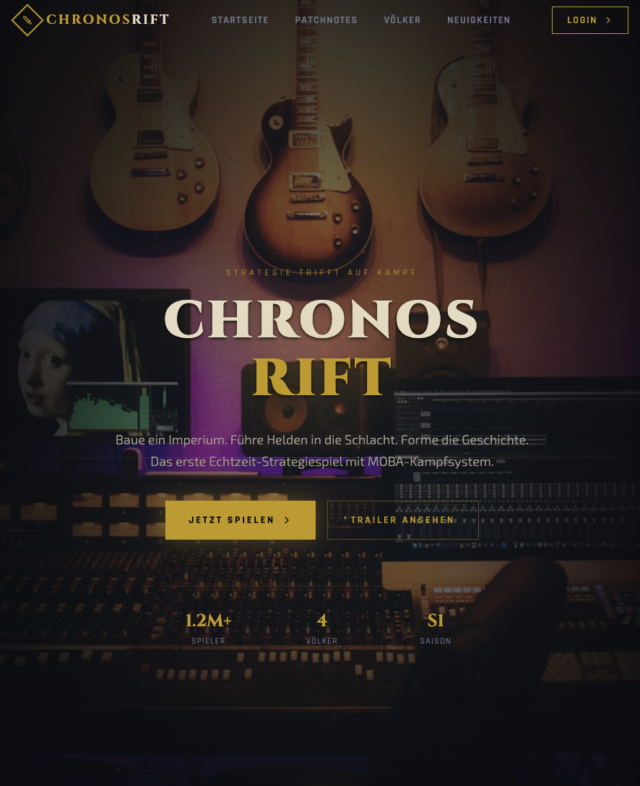

# ChronosRift

A fake landing page for a made-up strategy game, built as our first real Tailwind project. Team project with Eric and Pavel — the idea was to design a marketing/pre-launch page for a fictional "real-time strategy meets MOBA hero combat" game and see how far we could push Tailwind's utility classes without writing custom CSS.

**Live demo:** https://monkeydnaara.github.io/ChronosRift/

## What it is

Static, single-page mockup — no backend, no real login, no game behind it. Everything (Login, Sign Up, "Jetzt Spielen") is a dead link for now. The point of the exercise was the layout and styling, not functionality:

- Transparent nav bar that overlays a hero section, collapses into a mobile menu
- Custom Tailwind theme (`@theme`) with a game-appropriate color palette — yellow/gold accents, faction colors for four in-game factions
- Hero section with stats counters (players, factions, season)
- Content sections describing the (fictional) game concept

Copy is in German since that's how our team worked on it.

## Stack

Tailwind CSS via the browser CDN build (`@tailwindcss/browser`) — no build step, no npm install, just open `index.html`.

## Status / known rough edges

This was an early group project and is kept as a snapshot of that stage:
- Only the hero + intro sections are really finished; the rest of the page structure exists but isn't fully styled
- `signup_footer.html` is the standalone draft of the sign-up and footer section, which is now part of `index.html`

## Running it

Just open `index.html` in a browser. No install, no server needed. The live version is served by GitHub Pages straight from `main`.
